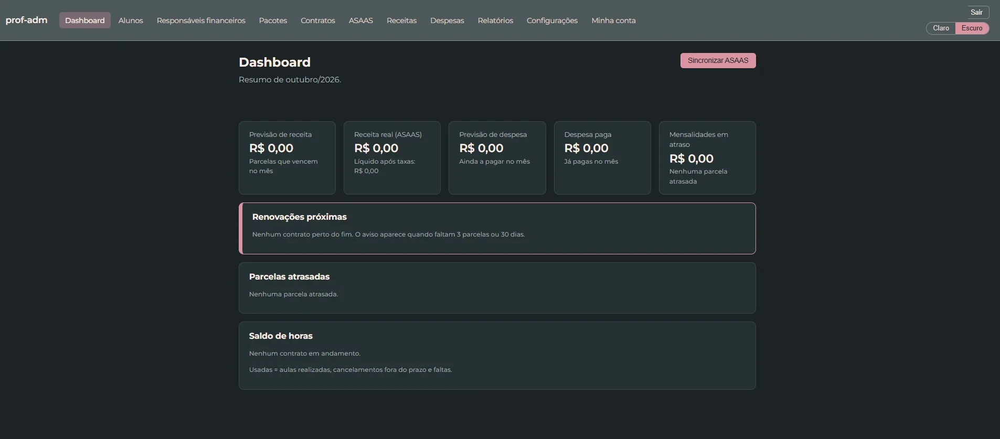
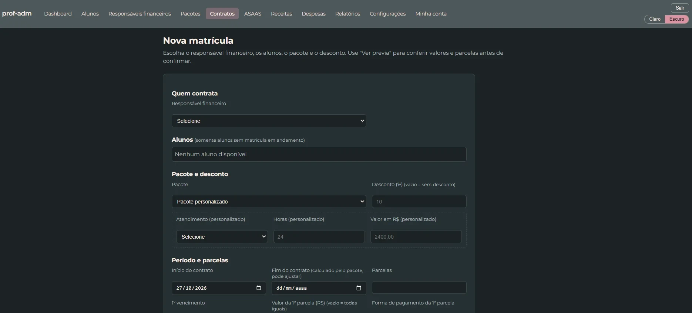
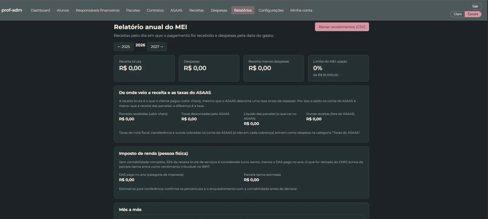
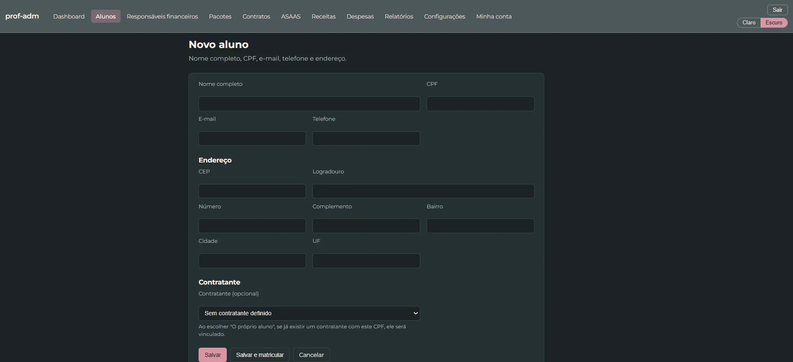
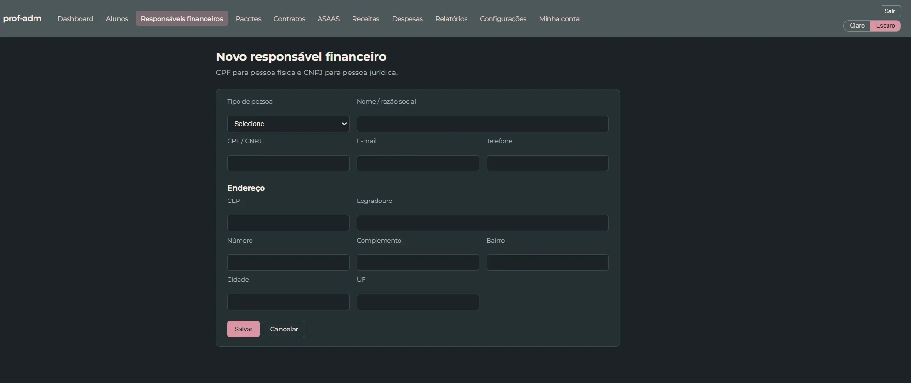
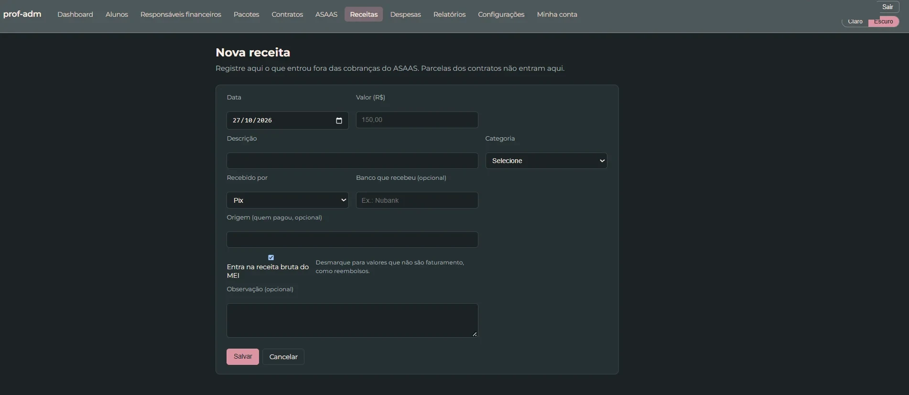
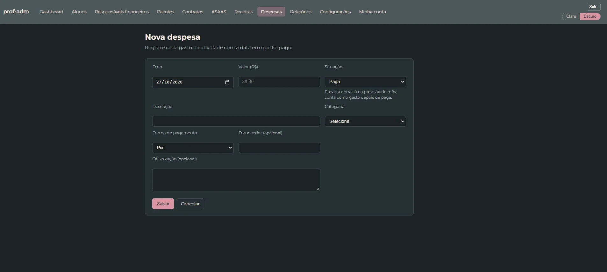

<h1 align="center">📚 Prof-Adm</h1>

<p align="center">
  Gestão de alunos, contratos, horas-aula e finanças para professores particulares.
</p>

<p align="center">
  
  
  
  
  
  
</p>

> ⚠️ O código-fonte deste projeto é privado. Este repositório apresenta o sistema, suas funcionalidades, a arquitetura e as telas.

---

## 📖 Sobre o projeto

Professores particulares costumam controlar alunos, pacotes de aulas, reposições e pagamentos em planilhas, cadernos e conversas de WhatsApp. Com o tempo, fica difícil saber quantas horas cada aluno ainda tem, quem está em atraso e quanto realmente sobrou no mês.

O **ProfAdm** nasceu para resolver isso para uma professora de inglês real, que já usa o sistema no dia a dia. Ele junta matrícula, contrato, cronograma de aulas, cobrança e financeiro em um só lugar. O próximo passo é evoluir o projeto para um **SaaS** para outros professores.

## ✨ Funcionalidades

**Alunos e contratos**
- 👩‍🎓 Cadastro de alunos e responsáveis financeiros (pessoa física ou jurídica, com validação de CPF/CNPJ)
- 📦 Pacotes de aulas com opções de parcelamento e tipo de atendimento
- 📝 Matrícula que gera o **contrato** automaticamente (Google Docs e PDF), com adendos, renovação e cancelamento com multa
- 🕓 Ciclo de vida completo do contrato, com histórico de cada alteração

**Aulas**
- 📅 Geração automática do **cronograma de aulas** a partir da agenda do contrato
- ⏱ Controle de **saldo de horas**, reposições, aulas canceladas e crédito de horas
- ⚠️ Regras de tolerância para atrasos

**Financeiro**
- 💳 Integração com o **Asaas**: cobranças por PIX e boleto, sincronização de pagamentos, saldo e extrato
- 📈 Entradas e despesas por categoria, forma de pagamento e taxas
- 📊 Dashboard e **relatório anual do MEI**: limite de faturamento usado, taxas do Asaas, estimativa de IRPF e exportação em CSV
- 📄 Exportação de documentos em PDF

**Segurança e operação**
- 🔐 Login com **verificação em duas etapas (TOTP)**, códigos de recuperação, "confiar neste dispositivo" por 30 dias e bloqueio após tentativas erradas
- 🗑 Lixeira e histórico de cadastros
- 💾 Backup automático do banco e dos arquivos, com cópia externa no Google Drive

## 📸 Telas

| Dashboard | Matrícula |
|---|---|
|  |  |
| **Relatório anual do MEI** | **Novo aluno** |
|  |  |
| **Responsável financeiro** | **Receitas** |
|  |  |
| **Despesas** | |
|  | |

## 🏗 Arquitetura

Monólito modular em **Spring Boot**, organizado por domínio (pacote por funcionalidade):

```
br.com.profadm
├── aluno          cadastro de alunos
├── pagador        responsáveis financeiros (CPF/CNPJ)
├── pacote         pacotes de aulas e parcelamento
├── contrato       matrícula, parcelas, adendos, histórico e PDF
├── cronograma     geração de aulas e saldo de horas
├── asaas          cobranças, sincronização, saldo e extrato
├── entrada        receitas
├── despesa        despesas
├── relatorio      relatório anual
├── dashboard      indicadores
├── google         OAuth e geração de contratos no Google Docs
├── usuario        usuários, 2FA (TOTP) e bloqueio de login
└── seguranca      Spring Security
```

- **Back-end:** Java 21, Spring Boot 4 (Web MVC, Data JPA, Security, Validation, Mail, Actuator)
- **Front-end:** Thymeleaf renderizado no servidor, HTML/CSS/JS
- **Banco:** PostgreSQL, com **19 migrações versionadas no Flyway**
- **Integrações:** API do Asaas (pagamentos) e Google Docs API (contratos)
- **Testes:** JUnit 5 e **Testcontainers** com PostgreSQL real (95 testes automatizados)
- **Infra:** Docker Compose em VPS Linux, **Caddy** com HTTPS automático e serviço de backup diário

## 🧠 Decisões técnicas

- **Monólito modular em vez de microsserviços:** uma professora usando hoje e deploy simples numa VPS de baixo custo. A separação por domínio deixa o caminho aberto para multi-inquilino (SaaS).
- **Thymeleaf em vez de SPA:** menos código, telas rápidas e segurança de sessão nativa do Spring.
- **Flyway:** o esquema evoluiu em 19 migrações versionadas, aplicadas automaticamente na subida da aplicação. O banco de produção nasce do zero com um único deploy.
- **2FA próprio com TOTP:** compatível com Google Authenticator e Authy, sem depender de serviço externo. Inclui códigos de recuperação e a opção de confiar no dispositivo por 30 dias (cookie assinado e invalidado quando a senha muda).
- **Asaas:** integração desenvolvida e testada no sandbox, hoje rodando com a conta real. A sincronização lê as cobranças e dá baixa nos pagamentos dentro do sistema.
- **Backup com restauração testada:** dump diário do banco e dos arquivos, com cópia externa no Google Drive.

## 🛣 Próximos passos

- [ ] Multi-inquilino (vários professores na mesma instância)
- [ ] Portal do aluno para ver aulas e pagamentos
- [ ] Recuperação de senha por e-mail
- [ ] Landing page e planos de assinatura

## 👨‍💻 Autor

**Paulo Júnior**: desenvolvedor Java e Flutter.

## 👨‍💻 Autor

**Paulo Júnior**, desenvolvedor Java e Flutter.

[](https://github.com/PauloFOJr)
[](www.linkedin.com/in/paulofojunior)
